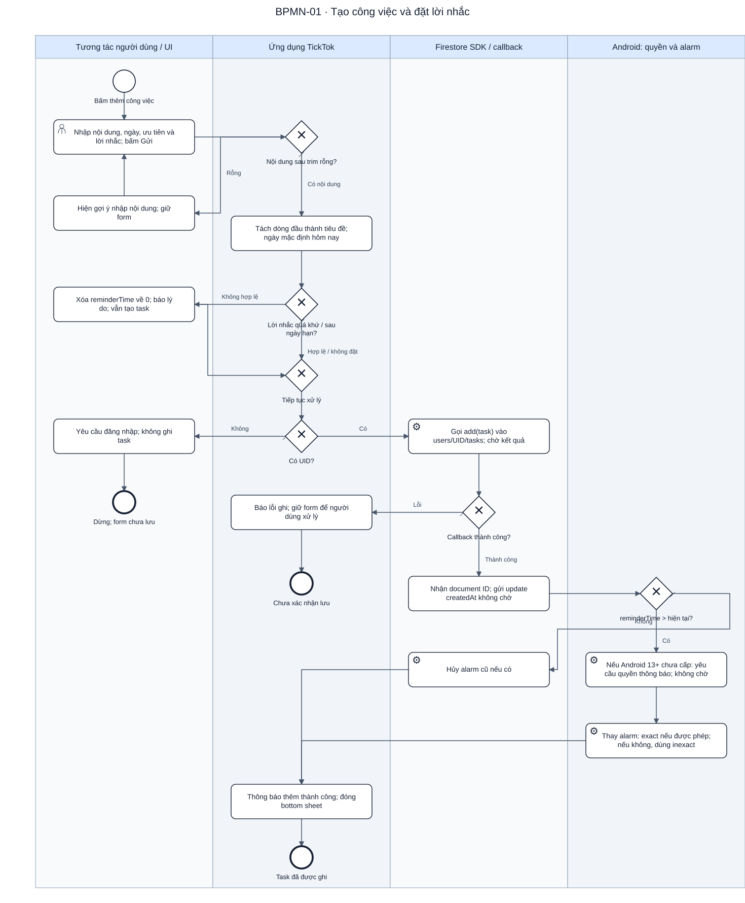
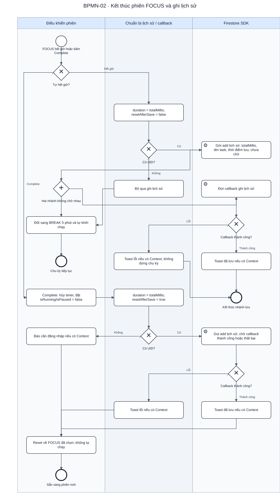
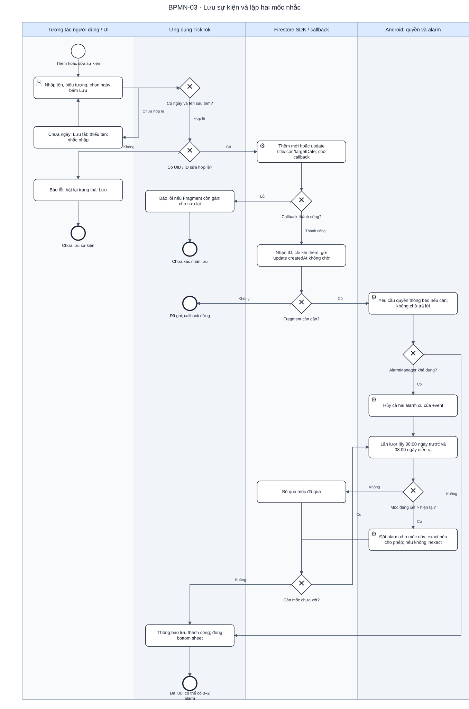

# 07. BPMN — Các quy trình quan trọng của TickTok

Phiên bản 1.0 · 18/11/2026 · quy trình nghiệp vụ TickTok. Ba mô hình tập trung vào các nhánh có ảnh hưởng đến dữ liệu và kết quả người dùng: thêm task/lời nhắc, kết thúc phiên tập trung và lưu sự kiện/lời nhắc.

## 1. Định dạng và cách đọc

| Mã | Quy trình | Bản xem | File nguồn chỉnh sửa |
| --- | --- | --- | --- |
| BPMN-01 | Tạo công việc và đặt lời nhắc | [SVG](01-create-task/diagram.svg) | [BPMN 2.0 XML](01-create-task/diagram.bpmn) |
| BPMN-02 | Kết thúc phiên FOCUS và ghi lịch sử | [SVG](02-focus-completion/diagram.svg) | [BPMN 2.0 XML](02-focus-completion/diagram.bpmn) |
| BPMN-03 | Lưu sự kiện và lập hai mốc nhắc | [SVG](03-event-reminders/diagram.svg) | [BPMN 2.0 XML](03-event-reminders/diagram.bpmn) |

File `.bpmn` chứa các phần tử BPMN, `sequenceFlow`, lane, điều kiện gateway và **BPMNDI** (tọa độ shape, label, waypoint), có thể mở/import vào trình biên tập tương thích BPMN 2.0 như bpmn.io hoặc Camunda Modeler. Đây là mô hình **`isExecutable=false`** phục vụ phân tích; không phải file triển khai ứng dụng lên workflow engine. [Tài liệu bpmn-js](https://bpmn.io/toolkit/bpmn-js/walkthrough/) mô tả hỗ trợ import/render BPMN 2.0 XML.

Ký pháp tham chiếu [BPMN 2.0.2 của OMG](https://www.omg.org/spec/BPMN/2.0.2/):

- Vòng tròn nét mảnh: start event; vòng tròn nét đậm: end event của một nhánh quy trình.
- Hình chữ nhật bo góc: task; biểu tượng người hoặc bánh răng phân biệt user task và service task.
- Hình thoi có `×`: exclusive gateway; chọn một luồng theo điều kiện. Nhánh mặc định biểu diễn trường hợp còn lại.
- Hình thoi có `+`: parallel gateway; sau khi tách, các token tiếp tục độc lập. Không dùng gateway này để khẳng định các dòng Java chạy đồng thời trên CPU.
- Mỗi mô hình dùng **một pool** và các lane trách nhiệm. Các lane SDK/Android là ranh giới trách nhiệm kỹ thuật trong một quy trình điều phối, không phải participant/pool độc lập. Vì vậy liên kết giữa lane dùng sequence flow; không có message flow băng qua một pool.

Lane “Tương tác người dùng / UI” gộp thao tác nhập liệu của con người với phản hồi hiển thị của app. Biểu tượng người chỉ xuất hiện ở user task; task báo lỗi/xóa lựa chọn vẫn là hành động ứng dụng trên giao diện, không phải quyết định của người dùng.

`serviceTask` gọi Firestore được mô hình hóa ở mức SDK/callback. Khi ghi “chờ kết quả”, quy trình chờ callback tương ứng; chưa mô tả một giao thức trao đổi message giữa hai tổ chức. Các biểu thức gateway là điều kiện mô tả, không được cấu hình thành mã thực thi Camunda. SVG sinh từ cùng node/edge với XML; trình biên tập có thể hiển thị font/label khác một chút.

## 2. BPMN-01 — Tạo công việc và đặt lời nhắc



**Phạm vi:** một lần gửi thêm task từ bottom sheet; UC-05, có thể nhận input do UC-18 cung cấp. Sửa task dùng cùng phần kiểm tra nhưng gọi `update`, không gọi `add`; không được coi là một lần tạo mới trong hình này.

**Tiền điều kiện giao diện:** form tồn tại; người dùng có thể chọn danh mục hoặc tạo task với `categoryId=null`. Người dùng chưa đăng nhập sẽ dừng ở kiểm tra UID, không được tự động đăng nhập thay.

| Điểm quyết định | Điều kiện / kết quả đang có |
| --- | --- |
| T_empty | `trim(rawInput)` rỗng → gợi ý nhập; chưa ghi task. |
| T_prepare | Dòng đầu là tiêu đề, phần còn lại là mô tả. Nếu chưa chọn hạn, lấy đầu ngày hôm nay theo thiết bị. |
| T_badreminder | Lời nhắc dương nhưng `<= now` hoặc `>= dueDate + 86.400.000` → xóa về 0, báo lý do, **vẫn tiếp tục lưu công việc**. |
| T_auth | Không lấy được collection theo UID → báo cần đăng nhập, giữ form. |
| T_result | Callback lỗi → báo lỗi và giữ form; callback thành công → nhận ID và gửi cập nhật `createdAt` riêng. Callback bổ sung này không được chờ để báo thành công tạo task. |
| T_future | Nếu lời nhắc vẫn ở tương lai, gọi xin quyền thông báo khi cần rồi đặt alarm; lời nhắc đã qua hoặc 0 → hủy alarm cũ nếu có. |
| T_schedule | Android 12+ kiểm tra khả năng exact; được phép dùng `setExactAndAllowWhileIdle`, còn lại `setAndAllowWhileIdle`. |

**Điểm quan trọng:** yêu cầu quyền Android 13+ là bất đồng bộ. Mã gọi đặt alarm tiếp sau yêu cầu quyền, không đợi người dùng cấp quyền xong. “Task đã được ghi” không đồng nghĩa người dùng chắc chắn nhận notification. Nếu `AlarmManager` không tồn tại, helper trả về; nếu đến lúc nhận mà chưa có quyền notification thì receiver bỏ qua hiển thị. Source chưa có timeout chờ ghi hoặc khóa chống nhấn gửi lặp ở form task; hình mô tả một lượt gọi, không cam kết chỉ có một bản ghi nếu người dùng gửi nhiều lần.

**Nguồn:** [AddTaskBottomSheetFragment](../../../app/src/main/java/com/example/ticktok/fragment/AddTaskBottomSheetFragment.java) — `handleSendTask`, `addNewTaskWithNextOrder`, `extractTitle`, `extractDescription`; [ReminderManager](../../../app/src/main/java/com/example/ticktok/reminder/ReminderManager.java) — `ensureNotificationPermission`, `setReminder`; [NotificationReceiver](../../../app/src/main/java/com/example/ticktok/reminder/NotificationReceiver.java) — `showTaskReminder`. Ánh xạ yêu cầu: FR-TASK-01, FR-TASK-06; quy tắc tương ứng ở [Business Rules](../requirements/BUSINESS_RULES.md).

## 3. BPMN-02 — Kết thúc FOCUS và ghi lịch sử



**Phạm vi:** xử lý một sự kiện kết thúc của **phiên FOCUS đang chạy hoặc tạm dừng**. Sự kiện đầu vào là `onFinish` hoặc nút Complete; không mô hình hóa toàn bộ vòng đời app, lựa chọn thời lượng hay thao tác pause/resume. Nút Complete khi không có phiên hoạt động không làm gì; Complete ở BREAK báo chỉ hoàn thành FOCUS rồi reset, nằm ngoài tiền điều kiện hình này.

| Nhánh | Dữ liệu / kết quả đang có |
| --- | --- |
| Hết giờ tự nhiên | Chuẩn bị dữ liệu và gọi `add` trước; sau khi phát yêu cầu, chuyển BREAK 5 phút và tự chạy mà không đợi callback. Nhánh callback có thể báo lưu thành công hoặc thất bại độc lập với chu kỳ đang chạy. |
| Hết giờ nhưng không có UID | Bỏ qua ghi lịch sử; luồng đổi sang BREAK vẫn tiếp tục. |
| Complete thủ công | Hủy timer, xóa trạng thái running/paused, gọi lưu với `resetAfterSave=true`. Callback thành công hoặc lỗi đều gọi reset về FOCUS với thời lượng đã chọn; không tự chạy tiếp. Nếu thiếu UID, có thể báo đăng nhập rồi reset. |
| Thời lượng được ghi | `max(1, totalMillis / 60_000)` phút. **Complete sớm vẫn ghi toàn bộ thời lượng cấu hình**, không phải số phút thực tế đã trôi qua. |
| Nội dung bản ghi | `userId`, `taskName` (hoặc tên mặc định), `duration`, `timestamp=System.currentTimeMillis()`. Không có `taskId` trong payload hiện tại. |
| Phản hồi UI | Toast chỉ hiển thị nếu callback giữ được Context. Save lỗi không được tự động retry riêng trong logic Fragment. |

Parallel gateway trong hình nằm **sau bước gửi `add`**, nhằm thể hiện việc tiếp tục phiên nghỉ và nhận callback độc lập. Java vẫn gọi hàm lưu trước khi đổi mode; không có yêu cầu rằng mode phải đợi Firestore phản hồi mới chuyển.

Khi BREAK hết tự nhiên, code đổi về FOCUS với thời lượng đã chọn và tự chạy; bước này được ghi như hậu cảnh của “Chu kỳ tiếp tục”, không được vẽ thành một lần lưu BREAK. Không áp dụng sơ đồ để khẳng định bộ đếm tồn tại sau khi tiến trình bị kill. `onDestroyView` hủy `CountDownTimer`; hàm khôi phục theo clock có thể nhảy qua các khoảng đã hết mà không bù bản ghi lịch sử. Source chưa có foreground service.

**Nguồn:** [PomodoroFragment](../../../app/src/main/java/com/example/ticktok/fragment/PomodoroFragment.java) — `handleCompleteButtonClick`, `onSessionCompleted`, `savePomodoroHistoryAndReset`, `savePomodoroHistory`, `handleResetButtonClick`, `onDestroyView`, `reconcileRunningStateWithClock`. Ánh xạ: UC-12; FR-POMO-03…06. Đối chiếu [đặc tả UC-12](../use-cases/SPECIFICATIONS.md).

## 4. BPMN-03 — Lưu sự kiện và lập hai mốc nhắc



**Phạm vi:** một lần thêm mới hoặc cập nhật sự kiện và gọi helper đặt alarm sau callback thành công; UC-11. Người dùng có thể chọn ngày quá khứ. Ngày đích được chuẩn hóa về 00:00 theo múi giờ thiết bị khi chọn ngày.

| Điểm quyết định | Điều kiện / kết quả đang có |
| --- | --- |
| E_valid | Chưa chọn ngày thì nút Lưu không bật; tên trim rỗng thì báo nhập tên. Biểu tượng để trống được thay bằng giá trị mặc định. |
| E_auth | Cần collection theo UID; khi sửa cần event ID hợp lệ. Lỗi → bật lại trạng thái cho phép lưu và báo lỗi. |
| E_save | Thêm mới dùng `add(event)`; sửa dùng `update(title, icon, targetDate)`. `isSaving` chống gửi lặp trong lúc chờ kết quả của form này. |
| E_timestamp | Chỉ nhánh thêm mới gửi bổ sung `createdAt=serverTimestamp`; không chờ kết quả này. |
| E_attached | Fragment không còn gắn thì callback dừng trước khi đặt lời nhắc hoặc báo thành công; dữ liệu đã được ghi trước đó. |
| E_request | Gọi xin quyền thông báo rồi tiếp tục; không có gateway đợi người dùng chấp nhận. |
| E_manager | Nếu không lấy được AlarmManager, helper trả về; form vẫn báo lưu thành công. |
| E_times | Hủy cả hai alarm cũ; chuẩn bị 08:00 ngày trước và 08:00 ngày diễn ra theo giờ địa phương. |
| E_future | Xét từng mốc độc lập: chỉ đặt nếu `triggerAtMillis > now`. Mốc đã qua bị bỏ qua. Có thể đặt 0, 1 hoặc 2 alarm. |
| E_more | Còn mốc thứ hai thì xét tiếp. Đây là vòng lặp hai phần tử được mô hình hóa để mô tả hai lời gọi helper nối tiếp trong code. |

Không giả định sự kiện quá khứ bị từ chối. Ví dụ, nếu hôm nay đã qua 08:00 và sự kiện diễn ra hôm nay, cả hai mốc có thể bị bỏ qua dù sự kiện được lưu thành công. Không có thao tác người dùng chọn giờ nhắc sự kiện riêng; mốc 08:00 được hard-code.

Nhánh thông báo khi alarm đến hạn được trừu tượng ngoài phạm vi lưu form: Android phát `PendingIntent` → `NotificationReceiver.showEventReminder` → kiểm tra quyền Android 13+ → nếu được cấp mới hiển thị nội dung theo loại ngày trước/ngày diễn ra. Bấm notification mở MainActivity; mã hiện tại không truyền điều hướng đến chi tiết event.

[EventFragment](../../../app/src/main/java/com/example/ticktok/fragment/EventFragment.java) còn gọi đặt lại alarm cho các event nhận từ snapshot khi mở màn sự kiện. Điều này là một điểm vào khác cho helper, không phải thao tác Lưu form trong sơ đồ. Xóa event thành công gọi hủy cả hai alarm trong nhánh riêng của màn danh sách.

**Nguồn:** [AddEventBottomSheetFragment](../../../app/src/main/java/com/example/ticktok/fragment/AddEventBottomSheetFragment.java) — `handleSaveAction`, `updateSaveEnabledState`, `showDatePicker`; [EventReminderManager](../../../app/src/main/java/com/example/ticktok/reminder/EventReminderManager.java) — `setEventReminders`, `scheduleIfFuture`, `buildReminderAtMillis`; [NotificationReceiver](../../../app/src/main/java/com/example/ticktok/reminder/NotificationReceiver.java) — `showEventReminder`. Ánh xạ: UC-11; FR-EVENT-01, FR-EVENT-02, FR-EVENT-05.

## 5. Tái tạo và kiểm tra

Từ thư mục gốc repo:

```bash
python3 scripts/generate_diagrams.py
```

Script chỉ dùng thư viện chuẩn Python. Mỗi graph sinh `.bpmn` và `.svg` từ cùng node/flow và kiểm tra XML, ID duy nhất, tham chiếu source/target/DI, đường đi từ start đến từng node và incoming/outgoing cơ bản. Phạm vi kiểm tra của script gồm cấu trúc XML và đồ thị luồng, không bao gồm xác thực đầy đủ XSD hoặc thực thi bằng workflow engine.

Thay đổi file `.bpmn` thủ công trong modeler cần lưu riêng hoặc cập nhật dữ liệu graph trước khi chạy lại script để tránh ghi đè thiết kế đã chỉnh. Dùng [Business Rules](../requirements/BUSINESS_RULES.md) và [SRS](../requirements/SRS.md) để đối chiếu điều kiện; ưu tiên mã nguồn nếu ứng dụng thay đổi sau ngày cập nhật tài liệu.
