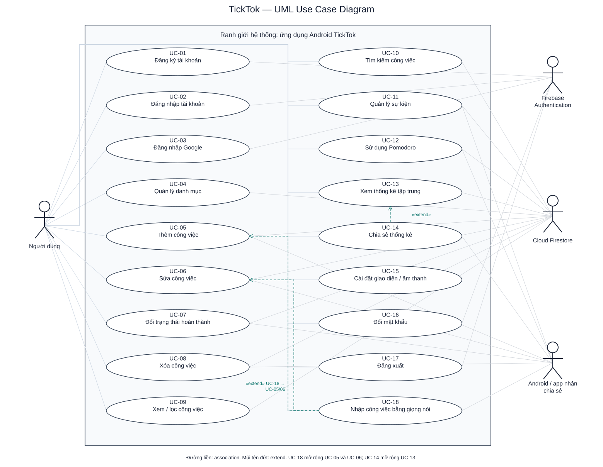

# 05. Use Case Diagram — TickTok

Phiên bản 1.0 · Ngày cập nhật: 18/11/2026. Mã UC dùng thống nhất với [đặc tả use case](SPECIFICATIONS.md).

## 1. Sơ đồ UML

- [Mở sơ đồ SVG để phóng to](diagram.svg).
- [Nguồn PlantUML có thể chỉnh sửa](diagram.puml). Mở bằng công cụ hỗ trợ PlantUML để dựng lại theo layout của công cụ đó.
- [Script sinh SVG và các sơ đồ BPMN](../../../scripts/generate_diagrams.py). SVG và PlantUML dùng cùng danh sách 18 use case; hình học bố trí được định nghĩa riêng cho từng định dạng.

Sử dụng actor hình người, use case hình ellipse và ranh giới hệ thống theo [UML 2.5.1 của OMG](https://www.omg.org/spec/UML/2.5.1). Đây là sơ đồ mục tiêu tương tác; trình tự bước được mô tả trong đặc tả và BPMN.

## 2. Ranh giới và actor

| Actor | Vai trò trong mô hình | Căn cứ |
| --- | --- | --- |
| Người dùng | Đăng ký, đăng nhập và quản lý dữ liệu cá nhân; actor chính. | Các Activity/Fragment của ứng dụng. |
| Firebase Authentication | Dịch vụ hỗ trợ xác thực, tạo tài khoản, đổi mật khẩu và kết thúc phiên. | [LoginActivity](../../../app/src/main/java/com/example/ticktok/activity/LoginActivity.java), [RegisterActivity](../../../app/src/main/java/com/example/ticktok/activity/RegisterActivity.java), [SettingsActivity](../../../app/src/main/java/com/example/ticktok/activity/SettingsActivity.java). |
| Cloud Firestore | Lưu/đọc danh mục, công việc, sự kiện và lịch sử Pomodoro; cung cấp snapshot/callback cho ứng dụng. | [UserFirestorePaths](../../../app/src/main/java/com/example/ticktok/util/UserFirestorePaths.java), [FirestoreCategoryDataSource](../../../app/src/main/java/com/example/ticktok/repository/FirestoreCategoryDataSource.java). |
| Dịch vụ Android / ứng dụng nhận chia sẻ | Hỗ trợ nhận dạng giọng nói, alarm/notification, chuông/rung và tiếp nhận nội dung chia sẻ qua intent. | [ReminderManager](../../../app/src/main/java/com/example/ticktok/reminder/ReminderManager.java), [EventReminderManager](../../../app/src/main/java/com/example/ticktok/reminder/EventReminderManager.java), [PomodoroFragment](../../../app/src/main/java/com/example/ticktok/fragment/PomodoroFragment.java), [FocusStatisticsActivity](../../../app/src/main/java/com/example/ticktok/activity/FocusStatisticsActivity.java). |

Actor cuối được gộp để sơ đồ tổng quan dễ đọc; các dịch vụ này có trách nhiệm khác nhau, được tách trong BPMN/phần mô tả. Google Sign-In hiện dùng Google Play services để lấy ID token rồi chuyển cho Firebase Authentication; không có màn hình quản trị viên trong ứng dụng. `CountDownTimer` và xử lý kiểm tra điều kiện là phần bên trong TickTok, không được vẽ như actor “Hệ thống” của chính nó.

## 3. Danh mục use case

| Mã | Mục tiêu người dùng | Yêu cầu liên quan | Nguồn chính |
| --- | --- | --- | --- |
| UC-01 | Đăng ký tài khoản | FR-AUTH-01 | `RegisterActivity.registerUser`, `AuthAccountMapper.toAuthEmail`. |
| UC-02 | Đăng nhập bằng tài khoản/mật khẩu | FR-AUTH-02 | `LoginActivity.loginUser`. |
| UC-03 | Đăng nhập Google | FR-AUTH-03 | `LoginActivity.startGoogleSignIn`, `firebaseAuthWithGoogle`. |
| UC-04 | Thêm/sửa/xóa/sắp xếp danh mục | FR-CAT-01…04 | `AddCategoryFragment`, `MainActivity`, `CategoryRepository`. |
| UC-05 | Thêm công việc | FR-TASK-01 | `AddTaskBottomSheetFragment.handleSendTask`, `addNewTaskWithNextOrder`. |
| UC-06 | Sửa công việc | FR-TASK-02 | `AddTaskBottomSheetFragment.newInstanceForEdit`, `handleSendTask`. |
| UC-07 | Đánh dấu hoàn thành hoặc bỏ hoàn thành | FR-TASK-03 | `onTaskCheckedChanged` trong các Fragment. |
| UC-08 | Xóa công việc | FR-TASK-04 | `deleteTask` trong các Fragment. |
| UC-09 | Xem/lọc/lịch/ma trận công việc | FR-VIEW-01…04, FR-TASK-05 | `WelcomeFragment`, `TaskFilterFragment`, `CalendarFragment`, `CategoryFragment`. |
| UC-10 | Tìm công việc và mở danh mục chứa kết quả | FR-SEARCH-01 | `SearchFragment.applyFilter`, `onTaskClicked`. |
| UC-11 | Thêm/sửa/xóa/xem sự kiện và lịch nhắc | FR-EVENT-01…05 | `AddEventBottomSheetFragment`, `EventFragment`, `EventAdapter`, `EventReminderManager`. |
| UC-12 | Chọn task và điều khiển phiên Pomodoro | FR-POMO-01…06 | `PomodoroFragment`. |
| UC-13 | Xem thống kê và lịch sử tập trung | FR-STAT-01…03, FR-STAT-05 | `FocusStatisticsActivity.loadPomodoroData`, `handlePomodoroSnapshot`. |
| UC-14 | Chia sẻ thống kê dạng văn bản | FR-STAT-04 | `FocusStatisticsActivity.shareCurrentStatistics`. |
| UC-15 | Chọn giao diện và lưu lựa chọn âm thanh | FR-SET-01…02 | `SettingsActivity`, `TickTokApplication`. |
| UC-16 | Đổi mật khẩu của tài khoản password | FR-AUTH-04 | `SettingsActivity.showChangePasswordDialog`. |
| UC-17 | Đăng xuất | FR-AUTH-05 | `SettingsActivity.performLogout`. |
| UC-18 | Nhập nội dung task bằng giọng nói | FR-TASK-06 | `AddTaskBottomSheetFragment.onMicrophoneClicked`, `startVoiceInput`. |

Cột nguồn ghi lớp/phương thức xử lý tương ứng. UC-04, UC-09 và UC-11 gom các thao tác liên quan theo mục tiêu sử dụng.

## 4. Association và quan hệ mở rộng

- Đường liền actor–use case là association: actor tham gia tương tác. Hướng dữ liệu và thứ tự xử lý được trình bày ở tài liệu khác.
- **UC-18 `extend` UC-05/UC-06:** người dùng chọn micro trong form task và thiết bị hỗ trợ giọng nói, quyền micro được cấp. Nội dung nhận về được đưa vào input; bước lưu task vẫn do người dùng gửi. Nếu đã có nội dung, kết quả giọng nói được nối thành dòng mới theo callback. Trạng thái hiển thị nút micro phụ thuộc input đang có chữ hay không.
- **UC-14 `extend` UC-13:** người dùng nhấn nút chia sẻ trên màn thống kê. Nội dung gửi là số liệu dạng text đang hiển thị, không phải xuất ảnh hay PDF.
- Đăng nhập là tiền điều kiện của các mục tiêu quản lý dữ liệu. Không dùng `include` để biểu diễn việc cứ mở công việc là đăng nhập lại.
- Việc ghi Firestore và đặt alarm là các bước thực hiện bên trong UC-05/06/11/12, không bắt buộc nâng lên thành mục tiêu độc lập của người dùng.

## 5. Giới hạn phản ánh trong mô hình

1. UC-09 phân ma trận theo `priority` 3/2/1/0; chưa tính khẩn cấp từ hạn công việc.
2. UC-13 lấy tối đa 300 phiên gần nhất và tối đa 40 bản ghi hôm nay; không mô tả báo cáo mọi thời kỳ.
3. UC-15 có lưu lựa chọn âm thanh; chưa thấy lựa chọn này được đọc khi phát chuông Pomodoro.
4. UC-16 chỉ hiện với provider `password`; lỗi yêu cầu đăng nhập lại được Firebase trả về, chưa có form re-authentication.
5. Nút quên mật khẩu (FR-AUTH-06) chỉ mở hướng dẫn liên hệ; không có use case gửi email reset mật khẩu hoặc quản trị tài khoản trong ứng dụng.
6. Xóa danh mục bao gồm xóa các task thuộc danh mục trong `MainActivity`; việc hủy alarm cho từng task trong nhánh xóa hàng loạt chưa có.

## 6. Đối chiếu

Xem [SRS](../requirements/SRS.md), [Business Rules](../requirements/BUSINESS_RULES.md), [đặc tả use case](SPECIFICATIONS.md) và [BPMN](../bpmn/README.md).
